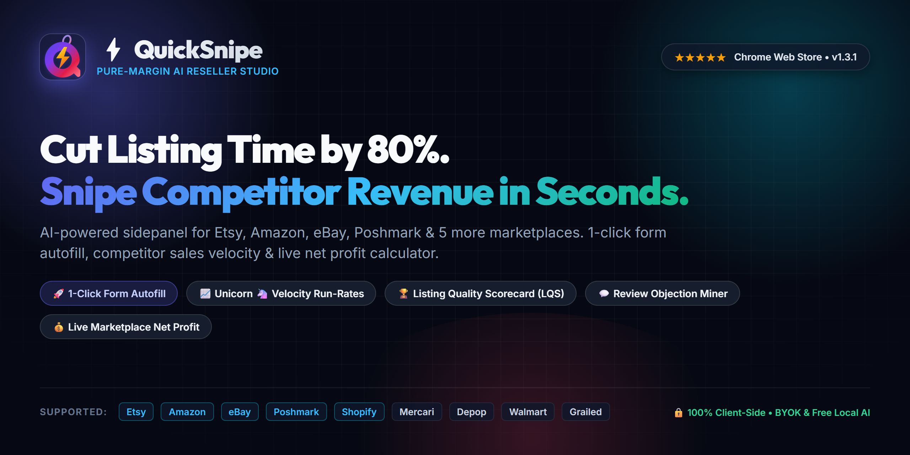

  

# ⚡ QuickSnipe — Support & Documentation Repository

### Official Developer Documentation, Issue Tracker & Diagnostic Hub

  <a href="https://radtome.github.io/QuickSnipe-support/"><b>🌐 Official Website &amp; Live Demos</b></a> •
  <a href="https://chromewebstore.google.com/detail/quicksnipe-ai-listing-res/aignalgmmlmnmofabamcdngdopabgkaa"><b>🛒 Chrome Web Store</b></a> •
  <a href="#-repository-navigation"><b>⚡ Navigation</b></a> •
  <a href="TROUBLESHOOTING.md"><b>🛠️ Troubleshooting</b></a> •
  <a href="FAQ.md"><b>❓ FAQs</b></a> •
  <a href="PRIVACY.md"><b>🛡️ Privacy Policy</b></a> •
  <a href="SUPPORT.md"><b>🆘 Support Policy</b></a> •
  <a href="https://github.com/RadTome/QuickSnipe-support/issues/new/choose"><b>🐛 Open Issue</b></a>

---

> [!IMPORTANT]
> ### 🌐 Looking for the Web Tools & Interactive Calculators?
> **This repository is dedicated to technical issue tracking, developer documentation, and support.**  
> For the interactive calculator suite, title quality grader, live sandboxes, and full feature tour, visit our live web portal:  
> 👉 **[https://radtome.github.io/QuickSnipe-support/](https://radtome.github.io/QuickSnipe-support/)**
> 
> * **[Marketplace Fee & Profit Simulator](https://radtome.github.io/QuickSnipe-support/marketplace-fee-calculator.html)** — Calculate net profits for eBay, Poshmark, Mercari, Etsy & Amazon.
> * **[Listing Title SEO & Character Grader](https://radtome.github.io/QuickSnipe-support/listing-title-grader.html)** — Audit 80-char eBay and 140-char Etsy titles in real time.
> * **[USPS Shipping Weight & Ounce Trap Calculator](https://radtome.github.io/QuickSnipe-support/shipping-weight-calculator.html)** — Avoid the 16 oz Ground Advantage cliff before buying postage.
> * **[Free Vendoo & List Perfectly Alternative Guide](https://radtome.github.io/QuickSnipe-support/vendoo-alternative-byok.html)** — Replace $30–$60/mo subscriptions with BYOK client-side architecture.

---

## ⚡ Repository Navigation

| Resource | Description | Link |
|---|---|---|
| 🌐 **Live Web Portal &amp; Sandboxes** | Official interactive web calculators and feature previews | [radtome.github.io/QuickSnipe-support](https://radtome.github.io/QuickSnipe-support/) |
| 📱 **Mobile Snap Companion** | Instant QR photo capture companion with P2P stream to desktop (zero app install) | [radtome.github.io/QuickSnipe-support/snap.html](https://radtome.github.io/QuickSnipe-support/snap.html) |
| 📋 **Release Notes &amp; Roadmap** | Full changelog for v1.4.2 and version history | [CHANGELOG.md](CHANGELOG.md) |
| 📖 **Support Policy &amp; SLA** | Support channels, response timelines, and ticketing policies | [SUPPORT.md](SUPPORT.md) |
| 🛡️ **Privacy Policy** | 100% client-side data handling, permissions &amp; Web Store compliance | [PRIVACY.md](PRIVACY.md) |
| 🛠️ **Troubleshooting Guide** | Diagnostics for scrapers, API keys, and DOM form autofill | [TROUBLESHOOTING.md](TROUBLESHOOTING.md) |
| ❓ **Frequently Asked Questions** | Common seller questions, safety, bans, and licensing | [FAQ.md](FAQ.md) |
| 🔒 **Security &amp; Disclosures** | Security vulnerability reporting and private advisories | [SECURITY.md](SECURITY.md) |
| 🐛 **Open a Bug Report** | Report broken scrapers, UI glitches, or extension errors | [Submit Bug](https://github.com/RadTome/QuickSnipe-support/issues/new?template=1_bug_report.yml) |
| 💡 **Request a Feature** | Request a new marketplace, AI model, or studio generator | [Submit Feature](https://github.com/RadTome/QuickSnipe-support/issues/new?template=2_feature_request.yml) |
| 💬 **Community Discussions** | Strategy, prompt sharing, and seller workflows | [GitHub Discussions](https://github.com/RadTome/QuickSnipe-support/discussions) |

---

## 🚀 Release Status: v1.4.2 Live in Chrome Web Store

QuickSnipe **v1.4.2** is officially approved, published, and live directly in the [Google Chrome Web Store](https://chromewebstore.google.com/detail/quicksnipe-ai-listing-res/aignalgmmlmnmofabamcdngdopabgkaa). Packaged and validated across **429 automated unit tests**, all existing users receive this update automatically via Google Chrome with zero data loss or configuration needed.

**Technical Highlights in v1.4.2:**
- **Omnichannel Cross-Lister & Floating QuickBar HUD**: Format listings for Etsy, eBay, Poshmark, Mercari, and Depop simultaneously. Extract full-resolution gallery photos into a clean ZIP archive with 1 click, and auto-populate listing forms via the floating QuickBar HUD.
- **USPS 16 oz Shipping Ounce Trap Advisor**: Real-time cliff radar alerts sellers at the critical 15.9 oz threshold before purchasing postage. Prevents 0.1–0.2 oz overages from triggering 1–2 lb Priority rates.
- **Sourcing & Flip Tracker CRM**: Local-first inventory CRM stored 100% on device in `chrome.storage.local`. Tracks thrift hauls, buy cost (COGS), purchase venue, sold date, net profit, and ROI% with 1-click IRS Schedule C CSV export.
- **Buyer Offer Negotiator & Counteroffer Matrix**: Audits buyer lowball offers on eBay, Poshmark, Mercari, and Depop. Calculates true net dollar take-home after fees and recommends 3 sweet-spot counteroffers.
- **Barcode & UPC Scanner**: Scan retail UPC, EAN, and ISBN barcodes on books, electronics, toys, and packaged goods via webcam or image upload with local canvas processing.

*For complete version history and legacy releases (v1.4.1, v1.4.0, v1.3.2), see [CHANGELOG.md](CHANGELOG.md).*

---

## 🛡️ Bring Your Own Key (BYOK) AI Setup Guide

QuickSnipe is built on a **100% Client-Side BYOK Architecture**:
- Your API keys are stored exclusively in your local browser storage (`chrome.storage.local`).
- Requests travel directly from your browser to official provider endpoints via HTTPS.
- **Zero middleman servers. Zero tracking. Zero subscription markups on AI tokens.**

### Supported AI Providers

| Provider | Recommended Model | Free Tier Available? | Key Signup Link |
|---|---|:---:|---|
| **Chrome Built-in AI** *(Offline)* | `gemini-nano` (On-Device) | **100% Free & Private** *(Slow: ~15–30s)* | Built into Chrome 131+ (Prompt API) |
| **Google Gemini** *(Strongly Recommended)* | `gemini-3.6-flash` / `gemini-2.0-flash` | **100% Free** (15 Req/Min • Sub-second speed) | [Google AI Studio](https://aistudio.google.com/app/apikey) |
| **Groq** | `llama-3.3-70b-versatile` | **Yes** (30 Req/Min free) | [Groq Console](https://console.groq.com/keys) |
| **OpenAI** | `gpt-4o-mini` / `gpt-4o` | Paid developer account | [OpenAI Platform](https://platform.openai.com/api-keys) |
| **Anthropic Claude** | `claude-3-7-sonnet` / `claude-3-5-haiku` | Paid developer account | [Anthropic Console](https://console.anthropic.com/settings/keys) |
| **DeepSeek** | `deepseek-chat` (V3) / `deepseek-reasoner` (R1) | Ultra-low cost | [DeepSeek Platform](https://platform.deepseek.com/api_keys) |
| **OpenRouter** | `google/gemini-2.0-flash-001` (200+ models) | Pay-as-you-go | [OpenRouter Keys](https://openrouter.ai/keys) |
| **Ollama** | `llama3.3` / `deepseek-r1:8b` / `qwen2.5` | **100% Free & Offline** | [Ollama.com](https://ollama.com/) |

### Configuring Your API Key in the Extension

1. Open QuickSnipe Sidepanel in Chrome by clicking the extension icon or pressing **`Alt+Q`**.
2. Click the **⚙ (Settings)** button in the top right header.
3. Select your preferred **AI Provider** from the dropdown.
4. Paste your API key into the input field.
5. Choose your target model and click **Save Settings**.
6. A green checkmark confirms successful connection.

---

## 🔒 Privacy & Permissions Architecture

QuickSnipe adheres strictly to Google Chrome Web Store Developer Policies and the principle of least privilege:

- **`storage`**: Saves your extension preferences, selected provider, API keys, and local swipe file snippets locally on your machine via `chrome.storage.local`.
- **`activeTab`**: Reads public DOM text (titles, prices, bullets, reviews) from the active marketplace tab when you open the sidepanel or click an action button.
- **`sidePanel`**: Renders the multi-tab Creator Studio dashboard side-by-side with your listing workflow.
- **`scripting`**: Dispatches form values during 1-Click Form Autofill and QuickBar interaction into your listing editor.
- **`alarms`**: Handles daily usage counter resets at midnight local time.
- **`contextMenus`**: Allows right-clicking any text on the web to "Save to QuickSnipe Swipe File".
- **`host_permissions`**: Allows direct client HTTPS communication with official AI API endpoints (`generativelanguage.googleapis.com`, `api.openai.com`, `api.groq.com`, `api.anthropic.com`, `api.deepseek.com`, `openrouter.ai`, `localhost`/`127.0.0.1`) and ExtensionPay (`extensionpay.com`).
- **`optional_host_permissions`**: Requested on-demand only if a user initiates analysis on arbitrary web pages outside default marketplace URL patterns.

QuickSnipe **does not** collect personal identities, sell browsing history, or run remote tracking analytics.

---

## 🆘 Getting Support & Reporting Issues

If you run into an issue, check these resources before submitting a ticket:

1. Review [TROUBLESHOOTING.md](TROUBLESHOOTING.md) for quick step-by-step diagnostic solutions.
2. Search existing [GitHub Issues](https://github.com/RadTome/QuickSnipe-support/issues) and [FAQ.md](FAQ.md).
3. If your issue is unresolved, choose the appropriate issue template:
   - [🐛 Bug Report](https://github.com/RadTome/QuickSnipe-support/issues/new?template=1_bug_report.yml)
   - [🛒 Marketplace Scraper Issue](https://github.com/RadTome/QuickSnipe-support/issues/new?template=3_marketplace_scraper_issue.yml) (Etsy, Amazon, eBay, Shopify, etc. changed their HTML)
   - [🔑 BYOK API / Model Issue](https://github.com/RadTome/QuickSnipe-support/issues/new?template=4_byok_api_issue.yml)
   - [💳 Billing & License Support](https://github.com/RadTome/QuickSnipe-support/issues/new?template=5_billing_license_support.yml)
   - [💡 Feature / Marketplace Request](https://github.com/RadTome/QuickSnipe-support/issues/new?template=2_feature_request.yml)

For complete support policies, response times, and billing inquiries, see [SUPPORT.md](SUPPORT.md).
