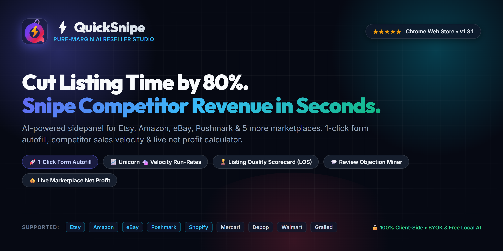
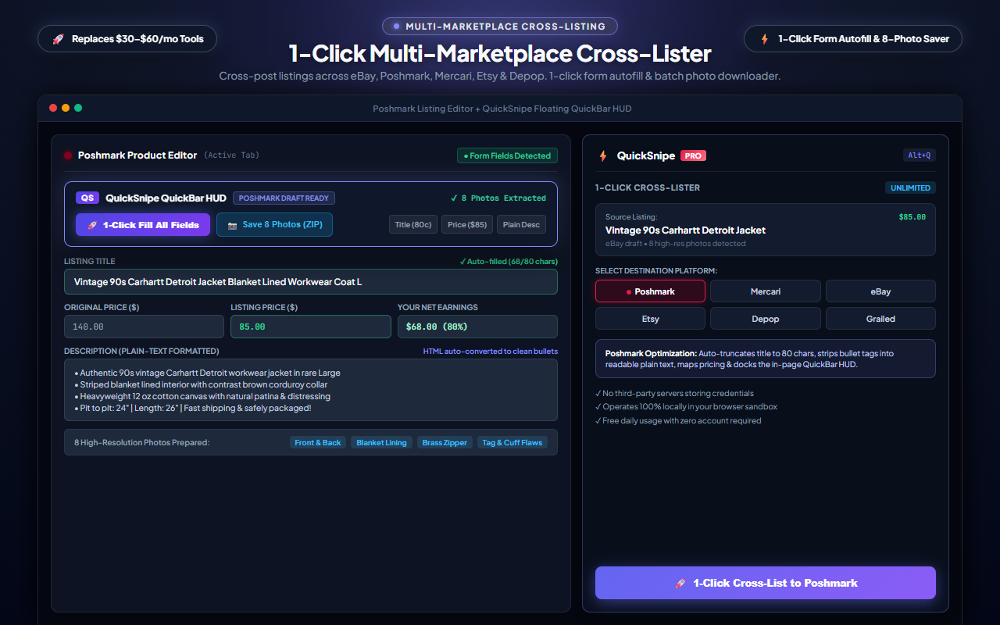
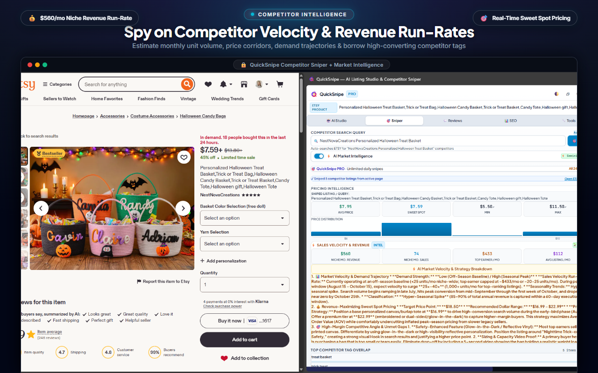

<div align="center">

<a href="https://chromewebstore.google.com/detail/quicksnipe-ai-listing-res/aignalgmmlmnmofabamcdngdopabgkaa">
  
</a>
<br><br>

# ⚡ QuickSnipe — 1-Click Cross-Lister & Reseller Copilot
### List Faster. Price with True Sold Comps. Stop Paying $30–$60/mo for Reseller Software.

[](https://chromewebstore.google.com/detail/quicksnipe-ai-listing-res/aignalgmmlmnmofabamcdngdopabgkaa)
[](https://chromewebstore.google.com/detail/quicksnipe-ai-listing-res/aignalgmmlmnmofabamcdngdopabgkaa)
[](#-pricing--free-daily-plan)
[](#-built-for-every-reselling-marketplace)
[](CHANGELOG.md)
[](PRIVACY.md)

<p align="center">
  <a href="https://chromewebstore.google.com/detail/quicksnipe-ai-listing-res/aignalgmmlmnmofabamcdngdopabgkaa"><b>🚀 Add to Chrome (Free)</b></a> •
  <a href="https://radtome.github.io/QuickSnipe-support/"><b>🌐 Interactive Web Portal</b></a> •
  <a href="#-whats-new-in-v145"><b>✨ What's New in v1.4.5</b></a> •
  <a href="#-core-features-at-a-glance"><b>🔥 Features</b></a> •
  <a href="#-quicksnipe-vs-incumbent-cross-listers"><b>⚖️ QuickSnipe vs. Vendoo</b></a> •
  <a href="#-30-second-quick-start-guide"><b>⚡ Quick Start</b></a> •
  <a href="FAQ.md"><b>❓ FAQs</b></a>
</p>

---

### 🎁 Free Forever • No Credit Card • No Signup • No API Keys Required
**QuickSnipe** lives in your **Chrome Side Panel**, right alongside your marketplace tabs. Cross-list active items in 1 click, check real landed sold prices with outlier filtering, spot underpriced flips on autopilot, beam photos wirelessly from phone to PC, and generate search-optimized listings in seconds.

</div>

---

## ✨ What's New in v1.4.5

| Feature | What It Does for Resellers |
|---|---|
| 📱 **Wire-Free Mobile Photo Sync** | Scan a QR code on your iPhone or Android camera to instantly beam thrift photos straight into your computer side panel. **Zero cables, zero cloud drive lag, and zero app downloads.** |
| 💎 **Modern Light Glass Theme** | Re-engineered high-contrast aesthetic with translucent glass cards, reducing visual fatigue during high-volume listing marathons. |
| ⚡ **Floating In-Page QuickBar HUD** | Docks directly onto listing forms across Etsy, eBay, Poshmark, Mercari & Depop. 1-click Fast-Fill injects title, description, price, tags, and condition with native synthetic DOM events. |
| 🏪 **Expanded 9-Platform Power** | Full listing generation, tag formatting, and margin calculations for **Etsy, eBay, Poshmark, Mercari, Depop, Amazon, Shopify, Walmart, and Grailed**. |
| 🏷️ **Promo Code `FOUNDER30`** | Activate in-app checkout for your **first month of Pro free**, then just $7.99/mo (cancel anytime). |

---

## 🔥 Core Features at a Glance

### 1. 🚀 1-Click Cross-Lister (Save $360–$720/Year)
Port your active inventory between marketplaces in seconds. Titles, tags, and formatted descriptions automatically adapt to destination constraints (e.g. 13 tags under 20 chars for Etsy, 80 chars for eBay, 5 hashtags for Depop). The floating **QuickBar** carries over up to 8 listing photos and fills forms in 1 click.

<div align="center">
  
</div>

### 2. 📱 Wire-Free Mobile Photo Sync (Phone-to-Chrome)
Resellers spend up to 40% of their prep time emailing photos to themselves or fighting cloud sync delays. With QuickSnipe:
1. Open the **Tools ➔ Photo Sync** tab in your side panel.
2. Scan the secure pairing QR code with your iPhone or Android camera.
3. Snap items at your photo table or thrift haul — photos beam directly to your PC in real time, ready to save to disk or send straight into AI Studio!

### 3. 🎯 Sold Comp Oracle & Outlier Removal (1.5x IQR)
Asking prices are fantasies; only **sold comps** pay the bills.
* **1.5x IQR Filtering:** Automatically discards junk, for-parts listings, and bulk lots to protect your margins.
* **0.88x Best Offer Factor:** Adjusts accepted strikethrough offers to reflect true transaction cash values.
* **Corridor Pricing:** Delivers **Quick Sale (25th percentile)**, **Market Median (50th percentile)**, and **Top Dollar (75th percentile)** targets.

<div align="center">
  
</div>

### 4. ⚖️ USPS Ground Advantage "Ounce Trap" Advisor
USPS postage jumps steeply at the 16.0 oz boundary (from ~$6.20 to $8.40+). QuickSnipe adds your packaging weight, calculates total ounces, warns you when heavy boxes risk pushing you over the cliff, and suggests lighter poly mailers so you stop burning profit at the post office.

### 5. 📡 Deal Radar — Saved Searches That Hunt For You
Save your buying criteria once: maximum buy price, expected resale target, profit floor, and negative keywords. QuickSnipe monitors marketplaces in the background, pinging you via desktop notifications and toolbar badges when underpriced inventory drops. Watch competitor shops for restocks and price drops.

### 6. 🤝 Buyer Offer Negotiator & Counteroffer Matrix
Stop guessing when lowballed. Input buyer offers on eBay, Poshmark, Mercari, or Depop to see your exact net cash after commission tiers and shipping splits, plus a 3-tier counteroffer matrix with a guaranteed profit floor.

### 7. 📦 Flip Tracker & 1-Click Schedule C Tax Rollup
Track every item from **Sourced ➔ Listed ➔ Sold**. View live KPIs (Invested Capital, Net Profit, ROI %), monitor aging inventory buckets (>90-day dead stock), and export 1-click accountant-ready IRS Schedule C CSV spreadsheets at tax time.

---

## ⚖️ QuickSnipe vs. Incumbent Cross-Listers

| Feature | QuickSnipe (v1.4.5) | Vendoo | List Perfectly |
|:---|:---:|:---:|:---:|
| **Monthly Cost** | **Free Forever** or $7.99/mo Pro | $29.99 – $59.99/mo | $29.00 – $69.00/mo |
| **Lifetime License** | **$69 (One-Time)** | ❌ No | ❌ No |
| **Signup Required?** | **None** (Works immediately) | Account & Password | Account & Password |
| **Credit Card to Test?** | **Zero** (7-Day Turbo Week Free) | Credit Card Required | Credit Card Required |
| **Mobile Photo QR Beam** | **Built-in (Zero Cables/Apps)** | ❌ No | Separate Mobile App |
| **Sold Comps & Demand Score**| **Built-in (1.5x IQR Filtered)**| Add-on / Separate | ❌ No |
| **USPS Ounce Trap Advisor** | **Built-in** | ❌ No | ❌ No |
| **Buyer Offer Negotiator** | **Built-in** | ❌ No | ❌ No |
| **Data Privacy** | **100% Local Browser Storage** | Cloud Database | Cloud Database |

---

## 🏪 Built for Every Reselling Marketplace

* **Etsy Shops:** 13 algorithm-optimized tags (≤20 chars), mobile-optimized titles, and profit calculations after renewals, payment processing, and transaction fees.
* **eBay Sellers:** Competitor sales velocity, automatic Item Specifics extraction, category fee schedules, and optional promoted listing ad cuts.
* **Poshmark Closets:** 1-click Fast-Fill for title, description, price and tags; buyer complaint insights; net payout after the standard 20% commission (or flat $2.95).
* **Mercari Curators:** Character-limit compliance, buyer hooks, trending hashtags, and net payout after commission and label fees.
* **Depop Sellers:** Aesthetic descriptions, sizing hooks, exactly 5 trending hashtags, and net calculations after payment fees (3.3% + $0.45).
* **Amazon Sellers:** 249-byte backend search term validation, bullet structure optimization, and ASIN title length compliance.
* **Shopify Stores:** Conversion-focused product descriptions, SEO page titles, meta descriptions, and collection tags.
* **Walmart Marketplace:** Shelf description formatting, key product highlights, and net margins after Walmart category referral fees.
* **Grailed Curators:** Streetwear and menswear tags, sizing hooks, condition formatting, and net payout calculations.

---

## ⚡ 30-Second Quick Start Guide

```
Step 1: Install from Chrome Web Store (1 Click)
   👉 Click "Add to Chrome" — your 7-Day Turbo Week starts instantly.

Step 2: Pin QuickSnipe 📌 (Don't let it disappear!)
   👉 Click the Chrome Puzzle Piece (🧩) in the top-right toolbar.
   👉 Click the Pin icon (📌) next to QuickSnipe.

Step 3: Open Anytime with Alt+Q
   👉 Press Alt+Q (or Option+Q on Mac) to toggle the Side Panel on any page.
```

---

## 💸 Pricing — Free Daily Plan Forever

* **🆓 Free Daily Plan (Forever, No Card):** 5 daily market scans, 3 ready-to-paste listing drafts, photo extractions, sold comp lookups, every fee & profit calculator, quality scorecard audits, 1 saved Deal Radar search, and 3 cross-posts.
* **⚡ Turbo Week (Automatic on Install):** 7 full days of unlocked Pro mode right out of the box — zero credit card, zero signup.
* **⭐ Pro:** $7.99/mo (**first month free with code `FOUNDER30`**), $49/year, or a **$69 one-time lifetime license**. Cancel anytime from Settings with 1 click.

---

## 🌐 Free Web Calculators & Online Tools

No extension installed yet? Test our free suite of standalone reseller web tools:

* **[Marketplace Fee & Profit Simulator](https://radtome.github.io/QuickSnipe-support/marketplace-fee-calculator.html)** — Calculate true net take-home for eBay, Poshmark, Mercari, Etsy & Amazon.
* **[Listing Title SEO & Character Grader](https://radtome.github.io/QuickSnipe-support/listing-title-grader.html)** — Audit 80-char eBay and 140-char Etsy titles in real time.
* **[USPS Shipping Weight & Ounce Trap Calculator](https://radtome.github.io/QuickSnipe-support/shipping-weight-calculator.html)** — Avoid the 16 oz Ground Advantage cliff before buying postage.
* **[Free Vendoo & List Perfectly Alternative Guide](https://radtome.github.io/QuickSnipe-support/vendoo-alternative-byok.html)** — Why local-first extensions beat $30–$60/mo cloud subscriptions.

---

## 🛡️ Privacy, Security & Technical Architecture

QuickSnipe is engineered as a **local-first, 100% client-side Chrome Side Panel application**:
* **Zero Middleman Servers:** Listing drafts, flip ledgers, and inventory data remain on your local machine (`chrome.storage.local`).
* **Passive Browser Automation:** Interacts with listing forms using standard DOM typing and input events. Never uses bot crawlers, headless automation, or account logins.
* **Optional BYOK Cloud Boost:** Connect your personal API key (Google Gemini, OpenAI, Claude, Groq, Ollama) in Settings anytime. Keys are stored encrypted in your local browser storage and never touch third-party servers.

---

## 💬 Community & Support

* **Documentation & Web Portal:** [https://radtome.github.io/QuickSnipe-support/](https://radtome.github.io/QuickSnipe-support/)
* **Community Discussions & Strategy:** [GitHub Discussions](https://github.com/RadTome/QuickSnipe-support/discussions)
* **Report a Bug or Scraper Issue:** [Open an Issue](https://github.com/RadTome/QuickSnipe-support/issues/new/choose)
* **Changelog & Version History:** [CHANGELOG.md](CHANGELOG.md)

---

<div align="center">
  <sub>QuickSnipe is an independent seller productivity extension. All product names, logos, and brands are property of their respective owners.</sub>
</div>
